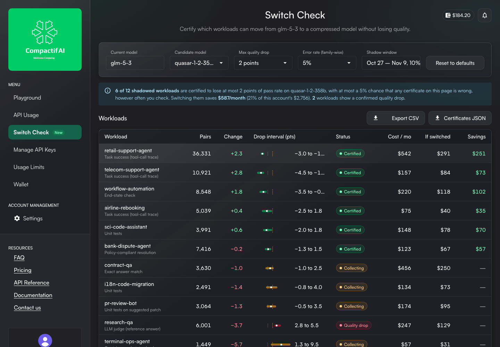

# Switch Check · certify which workloads can move to a compressed model

**Live demo:** https://mohith26.github.io/multiverse-switch-check/ · unofficial concept by Mohith Gajjela, not affiliated with Multiverse Computing.

CompactifAI sells the same model family at two price points: `glm-5-3` at $0.20 / $0.64 per 1M input/output tokens and the CompactifAI-compressed `quasar-1-2-358b` at $0.11 / $0.33. Multiverse's own model cards are honest that compression moves quality unevenly by task (Comet 60B is *ahead* of its base on τ²-Bench and *5.5 points behind* on GDPval-AA; "Quasar 438B is a specialist, and it should be evaluated as one"), and the API changelog has forced several migrations this year (`hypernova-60b` → `carina-60b`, `quasar-438b` → `quasar-1-2-358b`). So every customer has the same open question per workload: *is it safe to switch?* **Switch Check** answers it inside the CompactifAI Dashboard. A share of each workload's traffic is mirrored to the candidate model and scored by that workload's own grader. For every workload you get a certificate: the quality drop is below your limit (say 2 points of pass rate), with at most a 5% chance that *any* certificate on the page is wrong. That guarantee holds no matter how often you refresh the page, because the test is anytime-valid. Certified workloads can be switched with one click, and the same test keeps watching a holdback afterwards.



## Results (`data/results.json`, reproduced by the tests)

**Demo account** (12 shadowed workloads, 14 days of shadow traffic at 10%, 92,531 paired requests, limit 2 points, family-wise α = 5%):

| | |
|---|---|
| Certified safe to switch | **6 of 12** workloads (retail, telecom, workflow-automation, airline, sci-code, bank-dispute) |
| Confirmed quality drop (do not switch) | 2 (research-qa, report-drafting) |
| Still collecting | 4, with a computed pairs-to-decision estimate |
| Savings from switching the certified ones | **$587 of $2,756 a month (21%)** at CompactifAI list prices |

**Replay study** (1,000 independent replays of the whole account, `node scripts/results.mjs`). Four workloads truly lose 2 points or more on the candidate (pr-review-bot at 2.07, research-qa 3.24, terminal-ops 4.91, report-drafting 5.46):

| Rule | Replays where a degraded workload got approved | Safe workloads approved within 14 days | Median day to approve |
|---|---|---|---|
| Check a one-sided z-test every day (what a dashboard invites) | **20.4%** | 95% | 1 |
| Fixed 14-day z-test with Bonferroni (valid, but you may not look early) | 0.2% | 79% | 14 |
| **Switch Check (anytime-valid)** | **0.0%** | 66% | **3** |

Read it this way: daily peeking at a z-test approves a workload that lost more than 2 points in one replay out of five (almost always `pr-review-bot`, whose true drop of 2.07 sits just above the limit). Switch Check never did, and it still approves the clear wins in a median of 3 days. The price of looking whenever you want is power: at day 14 it has approved 66% of the safe workloads against 79% for a test you may only run once on day 14. The remaining ones keep collecting, and the page tells you how many more pairs each needs.

## How it works

1. **Pairs.** For each shadowed request both models answer and the workload's grader scores both (unit tests, end-state check, exact match, judge). D = pass(current) − pass(candidate) ∈ {−1, 0, 1}; the quality drop is Δ = E[D].
2. **Betting test per tolerance.** "Δ ≥ δ" is the null. With X = (1 − D)/2 ∈ [0, 1] and m = (1 − δ)/2, the wealth K_t = Π (1 + λ_i (X_i − m)) with predictable λ_i ∈ [0, 1/m) is a nonnegative supermartingale under the null, so by Ville's inequality P(sup_t K_t ≥ 1/α) ≤ α. λ_i is aGRAPA (Waudby-Smith & Ramdas, *Estimating means of bounded random variables by betting*, JRSS-B 2024), capped at 0.5/m.
3. **Anytime-valid interval.** The same test runs at every Δ on a 0.25-point grid in both directions; the values never rejected form a confidence sequence for Δ. A workload is **certified** when every grid value ≥ your limit has been rejected, and **flagged** when every grid value ≤ your limit has been rejected the other way.
4. **Many workloads.** α is split across shadowed workloads (Bonferroni, 5% / 12 here), so the 5% is a family-wise promise for the whole page.
5. **Time to decision.** From the observed mix of wins and losses, the optimal log-growth g* = max_λ E log(1 + λ(X − m)) gives pairs-to-decision ≈ (log(2/α_w) − log K_t) / g*.
6. **Cost.** CompactifAI list prices (input, cached input, output), with each workload's own token mix and cache share; the cost function reproduces both worked examples on the pricing page (tested).

## The app

- **Switch Check** page in the Dashboard menu (between API Usage and Manage API Keys), same shell as the live dashboard: logo card, MENU / ACCOUNT MANAGEMENT / RESOURCES sections, wallet chip and notifications bell.
- **Filters** like API Usage: current model, candidate model, max quality drop (1, 2, 3, 5 points), family-wise error rate (1, 5, 10%), shadow window.
- **Workloads table** with pairs, change, an interval glyph against your limit, status, cost now, cost if switched and savings, plus a green Total row; **Export CSV** and **Certificates JSON**.
- **Monthly cost chart** (MUI X Charts styling, as on the Token usage chart) with hover tooltips; click a bar to drill in.
- **Workload detail**: decision banner with Switch / Roll back / Stop shadowing, six KPIs, the drop with its anytime-valid band over time, the betting-wealth evidence against the decision threshold, and a per-day table with CSV export and a per-workload certificate download.
- **States**: loading skeleton, fetch error with Retry, empty state for a candidate with no shadow traffic (`carina-60b`) and for an unshadowed workload (`kb-rerank`), with actions that persist.
- Deep links (`#/switch-check/contract-qa?delta=2&alpha=5&cand=quasar-1-2-358b`), localStorage for settings and switched workloads, keyboard shortcuts (`j`/`k`, `Enter`, `Esc`, `s`, `e`, `?`), responsive to 1280 px. The full analysis of 92,531 pairs runs in the browser in about 150 ms.

## Data

- **True per-workload quality** (used only to simulate the shadow stream; the app never sees it): each workload borrows the base-model and compressed-model scores of the matching benchmark from Multiverse's published paired table for Comet 60B vs Nemotron 3.5 Super ([model card](https://huggingface.co/MultiverseComputingCAI/Comet_60B_A12B_NVFP4), BF16 columns), e.g. τ²-Bench retail 82.79 → 85.09, Terminal-Bench 2.1 60.67 → 55.76, GDPval-AA 74.51 → 69.05. Discordance rates (share of requests where the two models disagree) are 10-18%.
- **Prices**: docs.compactif.ai/pricing (2026-10-22 price change).
- **Traffic**: synthetic, seeded (`scripts/workloads.mjs`, `scripts/seed.mjs`): 13 workloads, weekday/weekend volumes, per-request token mixes and cache shares.

## Tests and reproducibility

```bash
node scripts/seed.mjs           # data/shadow.json (deterministic)
node scripts/results.mjs 1000   # data/results.json (~3 min)
node --test test/*.test.mjs     # 13 tests, ~5 s
python3 -m http.server          # open http://localhost:8000
```

13 tests: the joint distribution reproduces both marginals; pack/unpack round-trip (property test); the betting test certifies at most α of boundary-null streams when checked after every pair (randomized); wealth is a supermartingale under the null; clear wins certify and clear losses flag; the interval covers the true drop at every checkpoint (randomized); decisions agree with the bound and are nested across tolerances; the growth rate is positive exactly when the data favour the alternative; daily z-test peeking inflates false approvals while Switch Check does not, on the same streams; the cost model reproduces the pricing page's worked examples; the committed data equals the seeded generator; the family-wise split skips unshadowed workloads; and the headline numbers reproduce from the committed data. GitHub Actions runs them on every push.

## Prior art and what is new

- **Inside CompactifAI**: I checked the API docs (catalog, pricing, dashboard, FAQ), the full API changelog (2025-06 to 2026-11), the model cards and the dashboard's own bundle (pages: Playground, API Usage, Manage API Keys, Usage Limits, Wallet, Billing, Settings). Migration notices say "equivalent capabilities" but there is no per-customer evaluation, shadowing or comparison feature.
- **Elsewhere**: eval platforms (OpenAI Evals, Braintrust, LangSmith) compare models on offline datasets with fixed-sample statistics; LLM routers (Martian, Not Diamond) learn a quality/cost router; experimentation platforms (Statsig, Eppo, Optimizely) use always-valid sequential tests for product A/B metrics. The statistics here are published (betting confidence sequences). What is new is the product decision: paired, per-workload, anytime-valid *non-inferiority certificates* for switching an API customer to the provider's own compressed model, with a family-wise guarantee, pairs-to-decision, a one-click switch and continued monitoring, placed where the customer sees the bill.

## Limitations

- Synthetic traffic. Workload quality is borrowed from benchmark scores of a different model pair (Comet vs Nemotron 3.5 Super), because Multiverse publishes no per-task table for Quasar vs GLM; some of those scores are rubric means rather than pass rates.
- Pass/fail graders only. Graded scores (0-100) work with the same machinery after rescaling to [0, 1], but I have not built that.
- Requests are assumed exchangeable within a workload. If traffic drifts (new prompt mix), the certificate is about the mix that was shadowed; the post-switch holdback is what catches drift.
- Bonferroni is conservative; e-value based procedures (e-BH) would give more power across many workloads.
- Shadowing costs tokens on the candidate (about 10% of the workload's candidate cost while it runs) and needs a grader per workload; customers without one would need an LLM judge, whose own errors are not modelled here.
- The Switch, Roll back and Shadow-rate buttons change local state only.
